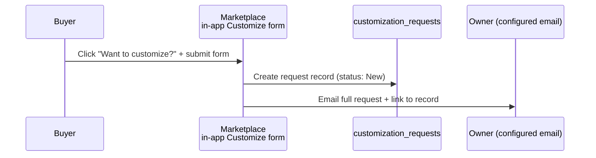

# NeoApps Marketplace — Product Requirements Document

**Product:** marketplace.neoapps.ai (working name: NeoApps Marketplace)
**Owner:** NeoApps.AI — Kaival
**Version:** v0.3 — Draft for review
**Date:** 24 November 2026
**Status:** Nothing built yet. Decisions marked Open require Kaival's sign-off before build.

## 2-minute overview

**Core idea in one line:** This is deploy, not download — the buyer pays and gets a live app running in their own NeoApps account, not a zip file to install.

**One account, two surfaces:** There is one NeoApps account, not a separate marketplace account. The identity lives on cloud.neoapps.ai; marketplace.neoapps.ai signs in against it, so one login, identity, roles, and admin rights work on both.

### High-level workflow

1. **Browse** — Visitor opens marketplace.neoapps.ai, browses categories or searches.
2. **Product page** — Visitor reviews description, screenshots, live preview, tables / roles / workflows included, ratings, and licence.
3. **Login** — Purchase and Customize both require login with the one NeoApps account (same account is the deploy target). No account? Create one on cloud.neoapps.ai and return to the product page.
4. **Purchase** — Buyer confirms licence and region, pays via Stripe checkout.
5. **Auto-deploy** — On payment success, Marketplace saves the listing's plan (app plan + database structure + workflows) into the buyer's NeoApps account via NeoApps Cloud and triggers publish. Deploy status is shown live: Queued → Saving Plan → Building → Publishing → Live / Failed.
6. **Live app presented** — Buyer gets the live app link, the app appears in My Apps / their NeoApps account, and receipt + deploy-live emails are sent. If deploy fails: auto-retry, then buyer retry or full refund — no paid order is left stranded.
7. **Purchase repository** — Every purchase stays in the buyer's account as an order record: item, price, date, deploy status, live app link, receipt, and redeploy action. The buyer can re-open any purchased app from My Apps at any time.
8. **Revise with their own AI** — After deploy, the buyer connects their own AI assistant to that same cloud account via the NeoApps MCP endpoint. The assistant can read the plan, change and revise the app, republish it, and help migrate it — all inside the buyer's own account.

**Separate path — Customize (can be used before or after purchase):**

1. Buyer clicks "Want to customize? Click here" below the Purchase button (login required).
2. In-app form opens, pre-filled with that product. Buyer describes custom changes, requirements, and workflow wanted.
3. On submit, a record is created in `customization_requests` and an email with the full form is sent to the notification address configured in platform settings. Request is then tracked: New → Contacted → Quoted → In Progress → Done.

### Data flow — sequence diagram

```mermaid
sequenceDiagram
    participant B as Buyer
    participant M as Marketplace<br/>marketplace.neoapps.ai
    participant S as Stripe
    participant N as NeoApps Cloud<br/>cloud.neoapps.ai (identity home)
    participant A as Buyer's Live App
    participant AI as Buyer's AI Assistant
    participant MCP as NeoApps MCP<br/>cloud.neoapps.ai/mcp

    B->>M: Login (one NeoApps account, SSO) + click Purchase
    M->>S: Create checkout (licence + region confirmed)
    B->>S: Pay
    S-->>M: Payment confirmed (webhook)
    M->>N: Save listing plan into buyer's account + trigger publish
    N->>A: Build and deploy app
    N-->>M: Deploy status: Building → Live (or Failed)
    M-->>B: Show live status, present app link, save order to My Apps repository
    B->>A: Open and use live app
    B->>AI: Connect assistant to cloud account
    AI->>MCP: Connect via MCP (OAuth, buyer's account)
    MCP->>N: Read plan in buyer's account
    AI->>MCP: Change / revise plan, request republish or migration
    MCP->>N: Save revised plan + republish
    N->>A: Deploy revised app
```

## 1. Executive summary

NeoApps Marketplace is a storefront for finished business applications generated by the NeoApps software factory. A buyer browses the catalog, reviews an application, purchases it, and the application is generated, built, and deployed live into their own NeoApps account. There is no file to download and nothing to install.

What is sold is not source code. It is a NeoApps application package: the app plan, the database structure, the roles and permissions, and the workflows documented inside that plan. NeoApps follows that package to create a working app in the buyer's account and region.

### What it is

- A curated catalog of ready-to-run NeoApps applications by industry and use case.
- A one-click purchase-to-deploy flow: pay, and the app appears live in your NeoApps account.
- A customization channel: after purchase, the buyer can request changes, and the request is routed to the platform owner by email and tracked in-system.

### What it is not

- Not a code-download store. The buyer never receives a zip file, source code bundle, or installer.
- Not an open app store in V1. V1 listings are NeoApps-curated factory apps only.
- Not a general freelance marketplace. Customization is a request-and-quote flow, not bidding.

The core difference from a traditional script marketplace is the delivery mechanism. Delivery is a deployment, with a status, a live URL, and a failure path — not a download link.

## 2. Reference analysis — script marketplace workflow, NeoApps version

The reference model is the established code marketplace pattern: developers list ready-to-use scripts, plugins, and app templates; buyers sign up, browse by category, review a product page with description, live demo, screenshots, ratings and author information, purchase a licence, and receive the files.

That model was reviewed on 24 November 2026. The table below maps it to the NeoApps version without copying its branding, wording, or pricing.

| Marketplace element | Traditional script marketplace | NeoApps Marketplace |
|---|---|---|
| Catalog | ~100,000+ code items across categories | Curated generated apps by industry / use case |
| Product | Code files, plugin, or template | App plan + database schema + workflows |
| Product page | Description, demo, screenshots, ratings | Description, live preview, screenshots, ratings |
| Delivery | Download files, install yourself | Deploy into buyer's NeoApps account |
| Buyer account | Marketplace account for download | NeoApps account is the deploy target |
| Licence | Regular vs Extended, per end product | One purchase = one deployment (see §9) |
| Seller entry | Author applies, uploads, staff review 7–14 days | V1: factory only. V2: submissions + review queue |
| Fees | Buyer fee on top; author fee ~50% flat | Revenue share — Open (see §13) |
| Support | Author provides docs + support period | Seller / NeoApps provides docs + support (period Open) |
| Quality signals | Featured items, featured creators, ratings | Featured apps, ratings, verified deploys |

### What carries over

- Browse and search by category, with filters and featured placements.
- A full product page: description, screenshots, demo or preview, ratings, reviews, seller information, version and update history.
- A review queue before a listing goes live, with the ability to reject.
- A licence concept tied to how the purchase may be used.
- Ratings and reviews as the primary trust signal.
- Seller payouts on a schedule once a threshold is met (V2).

### What changes

- **Deploy replaces download.** Purchase triggers plan save, build, and publish in NeoApps Cloud. The buyer gets a live app and a link, not files.
- **The NeoApps account replaces the download library.** The purchase is bound to the buyer's NeoApps account and region. Region is chosen at first deploy and cannot be changed afterwards, consistent with NeoApps apps generally.
- **Deploy state becomes a first-class object.** Queued, building, live, failed — with retry and refund paths. A traditional marketplace has no equivalent failure mode.
- **Customization is built into the product page flow.** Below the purchase action sits a second action — "Want to customize? Click here" — available after login, opening a structured request form inside the application.

## 3. Buyer journey end to end

1. **Discover.** Visitor lands on marketplace.neoapps.ai, browses categories (for example CRM, billing, EMR, inspections, inventory), searches, or opens a featured app.
2. **Review.** On the product page the visitor reads the description, views screenshots and a live preview where available, checks what is included (tables, roles, workflows), ratings, reviews, version, and licence terms.
3. **Sign in.** Purchase and customization both require login. If the visitor has no NeoApps account, they create one first; the marketplace account and the NeoApps account are the same identity (see M3).
4. **Purchase.** Buyer clicks Purchase, confirms licence and region, and pays via Stripe checkout.
5. **Deploy.** On payment success, the system saves the listing's plan into the buyer's NeoApps account, publishes it, and tracks deployment status live on screen. On completion the buyer is presented with the live application link.
6. **Use.** The deployed app appears in the buyer's library (My Apps) and in their NeoApps account. The buyer owns the deployed app and its data.
7. **Customize (optional).** Below the purchase action, the buyer clicks "Want to customize? Click here". A form opens inside the application. The buyer describes their custom changes, requirements, and the workflow they want, in the context of what the product description shows. On submit, a customization request record is created and an email is sent to the notification address configured in platform settings.
8. **Support.** Buyer can review the app, contact support, and request a refund under the refund policy (Open, §13).

Failure branch at step 5: if deployment fails after payment, the order must not dead-end. The buyer sees the failure, the system retries automatically where the failure is transient, and if the deploy cannot complete the buyer can trigger a manual retry or a refund. See M5 and §11.

## 4. Seller and creator side

### The listing is a generated app

A listing is not a file upload. It is a NeoApps application package containing:

- The app plan (modules, screens, roles, permissions).
- The database structure (tables, fields, relations).
- The workflows documented in the plan, including any AI workflows.
- Product documentation: description, screenshots, preview configuration, setup notes, changelog.
- Licence and support terms for that listing.

### V1 — curated factory catalog

V1 lists only applications produced by the NeoApps software factory and curated by the Admin. This keeps quality, deploy reliability, and support under NeoApps control while the purchase-to-deploy flow is proven. No third-party submissions in V1.

### V2 — seller submissions

V2 opens submissions to external sellers and developers:

- Seller applies and is approved as a seller.
- Seller submits a listing package; it enters the Admin review queue.
- Admin approves, requests changes, or rejects. No listing goes live without review.
- Approved listings are sold under the same purchase-to-deploy flow; payouts are handled in M9.

Seller-submitted apps must deploy through the same NeoApps plan and publish path as factory apps. A listing that cannot be expressed as a NeoApps plan cannot be listed.

## 5. Functional modules

Priority key: P0 = V1 must-have, P1 = V1 should-have or early V2, P2 = later.

### M1 — Storefront and discovery (P0)

- FR-1.1 Home page with featured apps, categories, and search. (P0)
- FR-1.2 Category browse by industry and use case, with filters for price range, rating, and licence type. (P0)
- FR-1.3 Full-text search across listing title, description, and tags. (P0)
- FR-1.4 Sort by featured, newest, best rated, price low to high, price high to low. (P1)
- FR-1.5 Only listings with status Live are publicly visible. (P0)

### M2 — Product pages and listings (P0)

- FR-2.1 Product page shows title, summary, full description, screenshots, included tables, roles and workflows, version, and changelog. (P0)
- FR-2.2 Live preview or demo link where the listing provides one. (P1)
- FR-2.3 Seller name and seller profile link, ratings summary, and review count. (P0)
- FR-2.4 Licence summary and support period shown before purchase. (P0)
- FR-2.5 Two actions on the page: Purchase (primary) and, below it, "Want to customize? Click here" (secondary, login required). (P0)
- FR-2.6 Listing states: Draft, In Review, Live, Suspended, Archived. Only Admin can move a listing to Live in V1. (P0)

### M3 — Accounts and NeoApps account link (P0)

- FR-3.1 Sign up and login use the NeoApps account. The marketplace does not maintain a separate password store. (P0)
- FR-3.2 Single sign-on between marketplace.neoapps.ai and NeoApps Cloud: a logged-in buyer purchases and deploys without a second login. (P0)
- FR-3.3 Login is required before purchase and before submitting a customization request. Anonymous browsing is allowed. (P0)
- FR-3.4 The buyer's NeoApps account ID and region are read at purchase time and recorded on the order. (P0)
- FR-3.5 If the buyer has no NeoApps account, the flow routes them to account creation and returns them to the product page. (P0)
- FR-3.6 **Resolved decision — one account, two surfaces.** There is no separate marketplace account system. The single NeoApps identity lives on cloud.neoapps.ai, which is the identity home; marketplace.neoapps.ai authenticates against it. The marketplace is not merged into cloud, and cloud is not converted into the marketplace — they remain two surfaces on one identity. (P0)
- FR-3.7 No separate marketplace credentials: a user never creates or maintains a second username or password for the marketplace. (P0)
- FR-3.8 The session carries across subdomains: signing in on one surface signs the user in on the other, and signing out ends the session on both. (P0)
- FR-3.9 The buyer's identity, roles, and admin rights from their cloud account apply in the marketplace. A user who is administrator of their cloud account / deployed app is administrator there in the marketplace context too — no second role setup. (P0)
- FR-3.10 Purchases, order history, deployments, and MCP access are all keyed to that one account ID. Nothing is keyed to a marketplace-only ID. (P0)
- FR-3.11 The exact SSO mechanism (shared session across subdomains vs OAuth) is a build-time implementation detail, not a product question. The product requirement is only the behaviour in FR-3.6 to FR-3.10. (P0)

### M4 — Checkout and payments (P0)

- FR-4.1 Checkout via Stripe for all payment collection, consistent with other NeoApps products. (P0)
- FR-4.2 Order is created in Pending Payment state; it moves to Paid only on confirmed Stripe payment. (P0)
- FR-4.3 One-time payment per app is the default model. Subscription pricing is V3 (see §12). (P0)
- FR-4.4 Buyer receives a receipt by email and can view invoices in My Apps. (P0)
- FR-4.5 Failed or abandoned payment leaves no deployment and no charge. (P0)
- FR-4.6 Taxes and currency handling follow Stripe configuration; pricing values are Open (§13). (P1)

### M5 — Deploy engine (P0)

This is the module that replaces download delivery.

- FR-5.1 On payment confirmation, the system saves the listing's plan into the buyer's NeoApps account via NeoApps Cloud and triggers publish. (P0)
- FR-5.2 Deployment states: Queued, Saving Plan, Building, Publishing, Live, Failed. State is shown live to the buyer. (P0)
- FR-5.3 On Live, the buyer is presented with the application link and the app is added to their library (M6). (P0)
- FR-5.4 The plan preview and approval pattern used inside NeoApps applies to the factory side when a listing package is created; the buyer's purchase is itself the approval to deploy that listing as described. Any deviation from this is Open (§13). (P0)
- FR-5.5 Transient deploy failures retry automatically with a visible attempt count. (P0)
- FR-5.6 Non-transient failure moves the order to Deploy Failed. The buyer can retry deployment or request a refund; the Admin is notified. No paid order may remain in Failed with no action available. (P0)
- FR-5.7 A purchase deploys once into one NeoApps account under the standard licence. Re-deploy after accidental deletion follows the licence and refund rules (Open, §13). (P0)
- FR-5.8 Every deploy attempt is logged with timestamps, NeoApps job reference, and error detail for Support. (P0)
- FR-5.9 Region is taken from the buyer's choice at checkout or their account default, recorded on the deployment, and fixed after first deploy. (P0)

### M6 — Buyer library / My Apps (P0)

- FR-6.1 Buyer sees all purchases with order status, deploy status, and live app link. (P0)
- FR-6.2 Buyer can open the deployed app, view the invoice, and view the licence for each purchase. (P0)
- FR-6.3 Buyer can submit a customization request and a review from the library entry as well as from the product page. (P1)
- FR-6.4 Purchases whose deploy failed surface the retry and refund actions here. (P0)
- FR-6.5 **Purchase history repository.** Every purchase is kept permanently as an order record in the buyer's account — this library is the buyer's repository of everything they have bought, not a transient post-checkout screen. (P0)
- FR-6.6 Each repository entry shows: item (listing and version bought), price paid, purchase date, order status, deploy status, live app link, licence, and receipt / invoice. (P0)
- FR-6.7 The buyer can re-open any purchased app from its repository entry at any time, and can redeploy from that entry where the licence allows it (see FR-5.7). (P0)
- FR-6.8 Order history is searchable / filterable by the buyer (by app, date, and status) once they have more than a few purchases. (P1)

### M6a — Post-purchase AI revision via MCP (P0)

After deploy, the app lives in the buyer's cloud account, so the buyer keeps changing it with their own AI assistant — the marketplace does not need a built-in editor for this.

- FR-6a.1 The post-deploy screen and every My Apps repository entry show "Connect your AI assistant" guidance: the NeoApps MCP endpoint (https://cloud.neoapps.ai/mcp) and the steps to connect. (P0)
- FR-6a.2 Connection is via MCP with OAuth using the buyer's one NeoApps account (see M3). No separate MCP account or marketplace credential is created. (P0)
- FR-6a.3 Through that connection the buyer's assistant can, inside the buyer's own account: read the deployed app's plan, change and revise the plan, republish the app, and help migrate the app. (P0)
- FR-6a.4 MCP access is bounded by the buyer's own account permissions and admin rights. An assistant connected to a buyer's account can only act on apps in that account. (P0)
- FR-6a.5 Revisions made via MCP go through the same NeoApps plan, preview, and publish flow as any other change to that app; the marketplace order and repository entry remain the record of the original purchase. (P0)

### M7 — Customization requests (P0)

The second action on every product page, and the primary services lead channel for the platform.

- FR-7.1 The "Want to customize? Click here" button is shown below the purchase action and requires login. (P0)
- FR-7.2 The form opens inside the application context and is pre-filled with the product (listing) the buyer is viewing. (P0)
- FR-7.3 Form fields: product (pre-filled, read-only), what in the current product description the request relates to, custom changes requested, additional requirements, workflow wanted, and buyer contact details. (P0)
- FR-7.4 A buyer who has not purchased the app can still submit a customization request; the request records whether a purchase exists. (P1)
- FR-7.5 On submit, the system creates a customization request record and sends an email to the notification address configured in platform settings (M11, Settings). (P0)
- FR-7.6 Request states: New, Contacted, Quoted, In Progress, Done, Closed. Admin and Support can update state and add internal notes. (P0)
- FR-7.7 The buyer can view the state of their own requests. Quoting and pricing of customization work happen outside the automated flow (Open, §13). (P1)
- FR-7.8 The notification email address is configurable by Admin in settings without a code change. (P0)

### M8 — Reviews and ratings (P1)

- FR-8.1 Only a buyer with a completed purchase can review a listing. (P1)
- FR-8.2 A review has a star rating (1–5), title, and body. One review per purchase. (P1)
- FR-8.3 Average rating and review count show on the product page and in search results. (P1)
- FR-8.4 Admin can hide a review for policy reasons; the rating recalculates. (P1)

### M9 — Seller dashboard and payouts (P2 — V2)

- FR-9.1 Seller dashboard shows their listings, sales, ratings, and earnings. (P2)
- FR-9.2 Earnings are calculated from completed, non-refunded orders less the platform revenue share (percentage Open, §13). (P2)
- FR-9.3 Payouts run on a schedule once a minimum threshold is met; schedule and threshold are Open (§13). (P2)
- FR-9.4 In V1 there are no external sellers, so M9 is inactive; factory sales are reported in Admin (M10). (P0)

### M10 — Admin and moderation (P0)

- FR-10.1 Admin manages categories, listings, featured placements, and listing states. (P0)
- FR-10.2 Listing review queue: approve, request changes, reject, suspend, and takedown, with a reason recorded. In V1 this governs factory listings; in V2 it governs seller submissions. (P0)
- FR-10.3 Admin views all orders, deployments (including failures), customization requests, and reviews. (P0)
- FR-10.4 Admin configures platform settings, including the customization notification email, featured apps, and licence texts. (P0)
- FR-10.5 Admin can issue a refund from the order record (executed via Stripe, M12). (P0)

### M11 — Notifications and email (P0)

- FR-11.1 Transactional email for: account and purchase receipt, deploy started, deploy live (with app link), deploy failed (with next steps), refund issued. (P0)
- FR-11.2 Customization request email to the configured platform address on every submission, containing the full form contents and a link to the request record. (P0)
- FR-11.3 Admin alerts for deploy failures and new customization requests. (P0)
- FR-11.4 All notification templates are editable by Admin; the destination address for customization requests is a setting, not hard-coded. (P1)

### M12 — Support and refunds (P0)

- FR-12.1 Buyer can contact Support from the product page, library, and order record. (P0)
- FR-12.2 Refund path: a deploy that cannot be completed is refundable in full. Other refund cases follow the refund policy (Open, §13). (P0)
- FR-12.3 Refund reverses the purchase record; the deployed app, if any, is handled per the refund policy. (P0)
- FR-12.4 Each listing states its support period and support channel before purchase (period value Open, §13). (P1)
- FR-12.5 Support tickets link to the order and deployment log so Support sees the full history. (P1)

## 6. Workflows

### W1 — Purchase to deploy

Buyer clicks Purchase → login check → Stripe checkout → payment confirmed → order Paid → plan saved into buyer's NeoApps account → publish triggered → deploy status tracked → Live: app link presented and library updated → receipt and deploy-live emails sent. On failure at any deploy step: automatic retry where transient, otherwise Deploy Failed with buyer retry or refund and Admin alert.

### W2 — Customization request

Buyer clicks "Want to customize? Click here" → login check → form pre-filled with the listing → buyer describes changes, requirements, and workflow wanted → submit → request record created in New state → email sent to the configured notification address → Admin or Support contacts the buyer → state moves through Contacted, Quoted, In Progress, Done.

### W3 — Listing publication (V1 factory, V2 sellers)

Listing package assembled (plan, schema, workflows, description, screenshots) → Draft → submitted to review queue → Admin approves → Live on storefront. Rejection or takedown records a reason and notifies the seller (V2).

### W4 — Refund

Buyer requests refund or deploy fails permanently → Admin reviews against refund policy → refund executed in Stripe → order marked Refunded → buyer notified by email → deployed app handled per policy.

### W5 — Review

Buyer with a completed purchase submits rating and review → review visible on product page → averages recalculate → Admin can hide for policy reasons.

### W6 — Seller payout (V2)

Period closes → earnings calculated from non-refunded sales less revenue share → sellers at or above threshold are paid → payout record created with period, gross, share, and net.

## 7. Data model

Approximately 12 tables. The marketplace is its own application; deployed buyer apps live in the buyers' own NeoApps accounts, not in these tables.

| Table | Purpose | Key fields |
|---|---|---|
| listings | One row per app for sale | id, seller_id, title, slug, description, category_id, price, licence_id, status, version, featured |
| listing_assets | Screenshots and preview config per listing | id, listing_id, type, file_ref, sort_order |
| sellers | Factory and (V2) external sellers | id, user_id, display_name, status, payout_details_ref |
| categories | Browse taxonomy | id, name, slug, parent_id, sort_order |
| licences | Licence definitions | id, name, terms_text, deployments_allowed |
| orders | Purchases (named purchases in UI) | id, buyer_user_id, listing_id, licence_id, amount, currency, stripe_ref, status, region, created_at |
| deployments | One row per deploy attempt | id, order_id, neoapps_account_id, region, neoapps_job_ref, status, attempts, error_detail, app_url |
| customization_requests | Customize form submissions | id, listing_id, buyer_user_id, order_id (nullable), relates_to, changes_requested, requirements, workflow_wanted, contact, status |
| reviews | Buyer ratings and reviews | id, listing_id, buyer_user_id, order_id, rating, title, body, hidden |
| payouts | Seller payout records (V2) | id, seller_id, period, gross, platform_share, net, status, paid_at |
| notifications | Sent email log | id, recipient, template, subject, related_type, related_id, sent_at, status |
| settings | Platform configuration | key, value — includes customization notification email, featured config, licence texts |

Relations: a listing belongs to one seller and one category and has many orders, reviews, and customization requests. An order has one buyer, one listing, and one or more deployments (retries). A customization request belongs to one listing and one buyer, and optionally to one order.

## 8. Roles and permissions

| Capability | Buyer | Seller / Developer | Admin | Support |
|---|---|---|---|---|
| Browse catalog | Yes | Yes | Yes | Yes |
| Purchase and deploy | Yes, own account only | Yes, as a buyer | Yes | No |
| View own library and orders | Yes | Own only | All | All, read |
| Submit customization request | Yes | Yes | Yes | No |
| Review a purchased app | Yes | Own purchases only | No | No |
| Create and edit listings | No | V2, own only | Yes, all | No |
| Approve, suspend, takedown listings | No | No | Yes | No |
| Manage categories and featured | No | No | Yes | No |
| View all orders and deployments | No | Own sales only (V2) | Yes | Yes, read |
| Process refunds | No | No | Yes | Request only |
| Manage customization requests | Own only | No | Yes | Yes |
| Configure settings and notification email | No | No | Yes | No |
| View payouts | No | Own only (V2) | Yes | No |

Admin is Kaival and delegated platform staff. A seller can never see another seller's sales, and a buyer can never see another buyer's orders, requests, or deployed apps.

## 9. Licensing

Proposed model, to be confirmed (§13):

- **Standard licence (proposed default).** One purchase grants one deployment into one NeoApps account, for that account owner's internal business use. The buyer owns the deployed application and all data entered into it.
- **The listing stays listed.** A purchase does not remove the listing, transfer the underlying plan as a standalone asset, or grant rights to resell the app.
- **No source-code delivery.** Consistent with §1, the licence grants a deployed application, not code files.
- **Commercial and multi-deployment tier (Open).** Whether a separate tier covers deploying the same app into multiple accounts, or offering the deployed app to paying end users, is an open question. If adopted, it is a second licence row in the licences table, priced separately.
- Licence name and summary appear on the product page and checkout before payment (FR-2.4, FR-4.2).

## 10. Integrations

| Integration | Used for | Notes |
|---|---|---|
| NeoApps Cloud | Save plan, publish, deploy status, app link | Core delivery path (M5). Marketplace calls the same plan and publish flow a NeoApps user triggers manually. |
| Stripe | All payment collection, receipts, refunds | Established pattern across NeoApps products. No other payment processor in V1. |
| Email service | Receipts, deploy status, customization request to configured address, Admin alerts | Destination address for customization requests is a platform setting (FR-7.8). |

No third-party analytics, affiliate, or external storage integration is specified for V1.

## 11. Non-functional requirements

- **Cloud-only.** The marketplace and all deployments are hosted. There is no offline mode and no local install, matching the NeoApps platform.
- **Buyer data isolation.** A purchase deploys into the buyer's own NeoApps account. Marketplace staff and other buyers have no access to the deployed app's data through the marketplace.
- **No paid-but-stranded orders.** Every Paid order must reach Live, or sit in a visible Failed state with retry and refund actions available to the buyer and visible to Admin. This is a release gate for V1.
- **Deploy transparency.** Deploy status and errors are shown to the buyer in plain language, with the full technical log available to Support.
- **Idempotent purchase handling.** A repeated Stripe confirmation or a retried deploy must not create a second charge or a duplicate app for the same order.
- **Audit trail.** Listing state changes, refunds, deploy attempts, and customization status changes are logged with actor and timestamp.
- **Performance target.** Storefront pages load as a standard NeoApps application; deploy duration is bounded by NeoApps Cloud publish times and is communicated as a status, not hidden behind a spinner.

## 12. Phased plan

### V1 — Curated catalog and purchase-to-deploy

- Storefront, categories, search, product pages (M1, M2).
- NeoApps account login and SSO (M3).
- Stripe checkout (M4).
- Deploy engine with live status, retry, and refund path (M5).
- Buyer library (M6).
- Customization requests with in-app form, record tracking, and email to the configured address (M7).
- Admin and moderation for factory listings, orders, and settings (M10).
- Notifications (M11) and support and refunds (M12).
- Catalog seeded with NeoApps factory apps only.

### V2 — Sellers, reviews at scale, payouts

- Reviews and ratings fully enabled (M8).
- Seller applications, submissions, and the review queue for external listings (M10 extension).
- Seller dashboard and payouts (M9).
- Featured sellers and richer quality signals.

### V3 — Growth

- Affiliates and referral tracking.
- Bundles (multiple apps sold together, deployed together).
- Subscription pricing as an alternative to one-time purchase.
- Commercial and multi-deployment licence tier, if adopted in §9.

## 13. Open questions

No values are assumed for the items below. Each needs Kaival's decision before the relevant module is built.

- Q1. Listing in V1 is factory-only in this draft. Confirm no external sellers until V2.
- Q2. Revenue share: what percentage does the platform keep on V2 seller sales?
- Q3. Pricing: one-time per app is proposed as the default model. What are the actual price points per app or per category?
- Q4. Licence terms: confirm the Standard licence in §9, and whether a commercial or multi-deployment tier is needed at launch.
- Q5. Refund policy: beyond a permanently failed deploy, in what cases is a deployed app refundable, and what happens to the deployed app on refund?
- Q6. Deploy region: does the buyer pick a region at checkout, or does the marketplace always use the account default? Region is fixed after first deploy.
- Q7. Customization pricing: is customization quoted per request after review (assumed in M7), or are any changes included with purchase?
- Q8. Customization notification: confirm the email address to configure in settings, and whether more than one recipient is needed.
- Q9. Payout schedule and minimum threshold for V2 sellers.
- Q10. Support period per purchase: how long is support included, and who provides it for V2 seller apps — seller or NeoApps?
- Q11. Deploy failure: after how many automatic retries does an order move to Failed, and is a partial deploy ever acceptable to present to the buyer?
- Q12. Plan preview: does the buyer see and approve the saved plan before publish, following the NeoApps preview pattern, or is purchase itself the approval (assumed in FR-5.4)?
- Q13. Free listings: can the factory list free apps (price zero, deploy without Stripe), or is every listing paid in V1?
- Q14. Updates: when a listing releases a new version, do existing buyers get the update, redeploy, or nothing?

## 14. Success metrics

- Purchase-to-live conversion: percentage of Paid orders that reach Live without Support involvement. This is the headline metric; the product fails if it is low.
- Median time from payment confirmation to live app link.
- Deploy failure rate, split by transient (auto-recovered) and permanent.
- Customization requests per 100 purchases, and percentage that convert to quoted work.
- Catalog metrics: product page views to purchase conversion per listing, average rating, refund rate per listing.
- V2 onward: active sellers, listings passing review first time, payout accuracy.

## 15. Risks

- **Deploy failure after payment.** The defining risk of a deploy-not-download store. Mitigated by M5 retry logic, the no-stranded-orders rule in §11, and a clear refund path — but a NeoApps Cloud publish problem becomes a marketplace refund problem immediately.
- **Deploy queue delays.** If NeoApps Cloud publishing is slow or queued, buyers wait with money spent. Status transparency (FR-5.2) and realistic expectations on the checkout page are required.
- **Listing quality in V2.** Opening submissions without a strict review queue reproduces the low-quality catalog problem of large script marketplaces. The review queue in M10 is not optional in V2.
- **Support load from customization.** The customize button will generate open-ended requests. The structured form (FR-7.3) and the quoted-not-included default (Q7) keep this manageable.
- **Licence disputes.** Buyers may expect source code or multi-account rights. The licence summary before purchase (FR-2.4) and §9 exist to prevent this; the terms must be settled in Q4 before launch.
- **Account and region mismatch.** A purchase bound to the wrong NeoApps account or region cannot be moved after deploy. Checkout must confirm account and region explicitly (FR-3.4, FR-5.9).

## 16. Resolved decisions

- **D1 — One account, not two (resolved 24 November 2026).** The marketplace does not have its own account system. One NeoApps identity lives on cloud.neoapps.ai (the identity home); marketplace.neoapps.ai authenticates against it via SSO / shared session across subdomains. One login works on both surfaces, and the buyer's identity, roles, and admin rights from their cloud account apply in the marketplace too. Neither surface is merged into the other — two surfaces, one identity. The exact SSO mechanism is a build-time implementation detail. See M3, FR-3.6 to FR-3.11.
- **D2 — Purchase-to-deploy flow confirmed.** Purchase inside the platform creates the deployment in NeoApps Cloud, and the buyer is presented with the finished live app website. See §3 and M5.
- **D3 — Purchase history is a repository in the account.** All purchases and order history are kept as order records in the buyer's account (My Apps), with the live app re-openable at any time. See M6, FR-6.5 to FR-6.8.
- **D4 — Post-purchase revision via MCP.** After deploy, the buyer connects their own AI assistant to their cloud account via the NeoApps MCP endpoint (https://cloud.neoapps.ai/mcp, OAuth with their account) to revise, change, republish, and migrate the deployed app inside their own account. See M6a.
